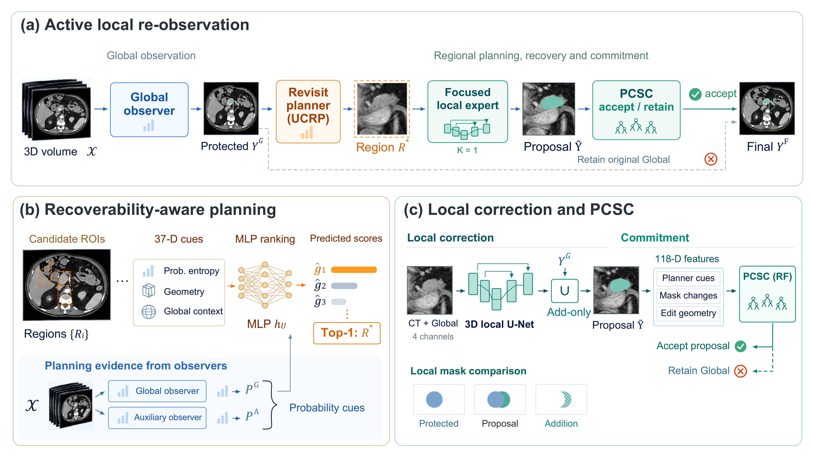

# MedRefocus · MSD Pancreas

[](https://github.com/LIN021/MedRefocus-MSD/actions/workflows/ci.yml)
[](LICENSE)

**Active local re-observation for missed-tumor recovery in volumetric segmentation.**

This repository contains the MSD Pancreas implementation of MedRefocus: candidate region generation, **UCRP** ranking, a focused **3D local expert**, **PCSC** commitment, and native-grid evaluation. [中文说明](README.zh-CN.md).



*One selected region, one local expert call, and proposal-level commitment with a protected Global fallback.* [Vector SVG](assets/medrefocus_framework.svg) · [PDF](assets/medrefocus_framework.pdf)

## How it works

1. **Observe.** A Global nnU-Net and a separately trained Auxiliary observer produce whole-volume probability fields.
2. **Plan.** Uncertainty-Conditioned Recoverability Planning (UCRP) ranks candidate regions using 37 prediction-derived features and selects **one** ROI.
3. **Re-observe.** A four-channel local expert receives CT, Global pancreas probability, Global tumor probability and the Global hard mask. Auxiliary probabilities guide planning.
4. **Commit.** Tumor voxels are added within the selected ROI. Proposal-Conditioned Selective Commitment (PCSC) assesses 118 descriptors and accepts the complete proposal or retains the **complete original Global prediction**.

The expert is called once per patient (**K = 1**). Add-only protects existing tumor voxels; an addition can still be a false positive. Reference annotations supply training targets and evaluation metrics. The prediction entry point never reads them.

## Install

Use Python 3.10 or 3.11 in a fresh environment. Install the PyTorch build appropriate for your machine, then:

```bash
git clone https://github.com/LIN021/MedRefocus-MSD.git
cd MedRefocus-MSD
python -m pip install -e '.[dev]'
medrefocus --help
python -m pytest
```

nnU-Net is an upstream dependency for observer training; it is installed separately as described in the [training guide](docs/TRAINING.md). MedRefocus tests run on CPU using synthetic volumes.

## MSD workflow

Download **Task07_Pancreas** from the [Medical Segmentation Decathlon](http://medicaldecathlon.com/), retaining the dataset's own terms. Labels are background `0`, pancreas `1`, tumor `2`.

```bash
# Convert locally downloaded data and create patient-disjoint outer/inner splits.
medrefocus prepare-msd --source data/Task07_Pancreas --output data/Dataset007_Pancreas
medrefocus split --dataset data/Dataset007_Pancreas --output data/splits_nested.json
```

Train the two observers **within each outer training partition** and export their probabilities on the native CT grid. The [complete training guide](docs/TRAINING.md) provides preparation, observer and downstream commands. Existing outer splits can be supplied with `split --outer-splits`; generated splits are a fresh deterministic experiment.

```bash
# After observer exports are available in upstream/fold0/{global,auxiliary}/:
medrefocus manifest --dataset data/Dataset007_Pancreas \
  --splits data/splits_nested.json --fold 0 --upstream upstream/fold0 \
  --output data/fold0.csv
medrefocus check --manifest data/fold0.csv --training
medrefocus train --manifest data/fold0.csv --config configs/msd_pancreas.yaml \
  --fold 0 --output runs/fold0 --device cuda
medrefocus predict --manifest data/fold0.csv --models runs/fold0 \
  --role test --output runs/fold0/final --device cuda
medrefocus evaluate --manifest data/fold0.csv --predictions runs/fold0/final \
  --output runs/fold0/evaluation
```

Repeat for folds 1–4. Each patient belongs to exactly one outer test fold. See [data contracts](docs/DATA.md), [inference](docs/INFERENCE.md) and [evaluation](docs/EVALUATION.md).

## Paper-reported MSD results

| Method | Dice (%) ↑ | NSD at 2 mm (%) ↑ | Complete misses ↓ |
|---|---:|---:|---:|
| Global nnU-Net v2 | 51.21 | 49.98 | 47 |
| MedRefocus | 55.47 | 53.72 | 19 |

The paper reports 28 positive-overlap recoveries among 47 initial misses across 281 CTs; 12 attained Dice ≥25% and three attained ≥50%. These are **paper-reported aggregate values**, also provided as [CSV](results/paper_msd_summary.csv). The repository does not bundle trained checkpoints or patient data. Fresh training produces its own checkpoints and measurements; the synthetic smoke test verifies execution and contracts.

## Contents

```text
medrefocus/
  ucrp/             # candidate generation, 37-D features, MLP
  local_expert/     # four-channel native-spacing 3D U-Net
  pcsc/             # 118-D features and commitment forest
  training.py       # inner fitting/selection, then model freezing
  inference.py      # K=1 add-only correction and whole-map fallback
  evaluation/       # whole-volume Dice, NSD, HD95 and recovery
configs/            # MSD defaults
docs/               # data, training, inference and evaluation guides
scripts/            # seeded nnU-Net observer training helper
tests/              # CPU synthetic integration and contract tests
```

## License and dependencies

MedRefocus code is released under the [MIT License](LICENSE). Dataset and dependency licenses remain with their respective owners. Observer training uses [nnU-Net](https://github.com/MIC-DKFZ/nnUNet); area-weighted NSD and HD95 use [surface-distance](https://github.com/google-deepmind/surface-distance). See [third-party notices](THIRD_PARTY.md) and [CITATION.cff](CITATION.cff).
